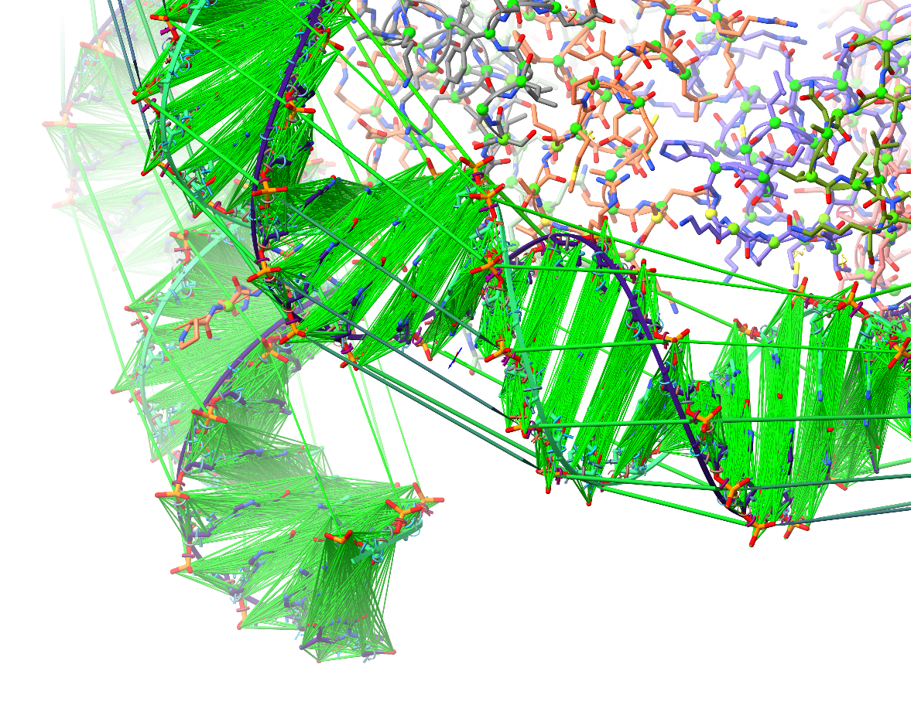

# ChimeraX-ISOLDE-DNA_RESTRAINTS

Plugin for Chimerax ISOLDE adding functionality to generate comprehensive restraints for double-stranded B-form DNA. 



## Commands

| Command | What it does |
|---|---|
| `isolde restrain b-dna <residues> [springConstant k] [torsions t/f] [distances t/f] [reset t/f]` | Restrain two paired DNA chains to B-form: adaptive torsion restraints (alpha–zeta, sugar v0–v4, chi1/chi2) and adaptive distance restraints (groove-width P–P, base-pair, intra-nucleotide). Default spring constant 5000 kJ/mol/rad². |
| `isolde adjust b-dna <residues> [backbone] [sidechains] [angleRange deg] [alpha a] [springConstant k]` | Change width/strength of existing B-DNA torsion restraints. |
| `isolde release b-dna <residues> [backbone] [sidechains]` | Switch those torsion restraints off (distance restraints are not touched). |
| `isolde stepgap [next\|prev] [model m] [polymericOnly t/f] [select t/f] [viewDistance d] [interpolateFrames n]` | Jump ISOLDE's residue stepper to the next/previous numbering gap or chain break. |

Help page: `help isolde restrain b-dna` (or `usage`) once installed.

## Requirements

- ChimeraX 1.12 and ISOLDE 1.12 (Toolshed). Pure Python, no compiler.

## Install

Open ChimeraX and execute the following commands in the ChimeraX console:

```bash
cd /path/to/this/repo
devel install .
```

## Notes

Geometry parameters are derived from an ideal B-form DNA model generated with Coot (Nucleotide Builder tool).

## Known limitations

- DNA dihedral definitions are registered with ISOLDE's per-session dihedral manager the first
  time one of the `b-dna` commands runs. A saved session that contains B-DNA torsion
  restraints may therefore not restore correctly in a fresh ChimeraX until a `b-dna` command
  has been run once. (Not tested. A start-up hook via a custom `initialize` would fix this.)
- The residues given to `isolde restrain b-dna` must be exactly the two paired strands.
